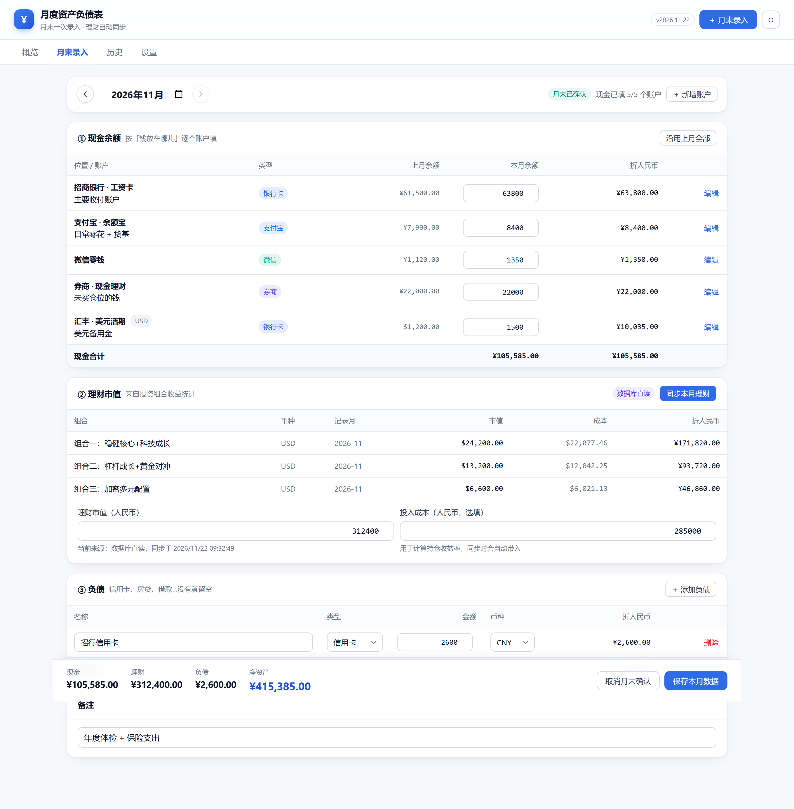

# 月度资产负债表

> 每月月底花三分钟，记下现金余额、点一下同步理财，就能看到自己的净资产曲线。
> 理财部分直接对接姊妹项目 [portfolio-tracker（投资组合收益统计）](https://github.com/caddaric9527/portfolio-tracker)，不用重复录入持仓。


## 它解决什么问题

记账软件大多记的是「流水」，月底还是不知道自己有多少钱。这个工具只做一件事：**每个月存一张资产负债表快照**。

- **现金**：按「钱放在哪儿」逐个账户填（工资卡、支付宝、微信零钱、券商现金、美元活期…），支持 CNY / USD / HKD 自动折算人民币。
- **理财**：不手填。从 portfolio-tracker 同步各投资组合的市值与成本，自动折成人民币，并保留每个组合的明细。
- **负债**：信用卡、房贷、借款，选填。
- **净资产** = 总资产 − 总负债，按月看走势、看环比、看资产结构。

## 界面

| 月末录入 | 历史月报 |
| --- | --- |
|  |  |

| 设置（理财数据源 / 汇率 / 备份） | 手机端 |
| --- | --- |
|  |  |

## 快速开始

### 方式一：Docker（推荐）

```bash
git clone https://github.com/caddaric9527/monthly-balance-sheet.git
cd monthly-balance-sheet
cp .env.example .env      # 改一下 HOST_PORT 和 AUTH_PASSWORD
docker compose up -d --build
```

打开 `http://你的IP:8899`，用 `AUTH_PASSWORD` 登录。

### 方式二：直接跑

```bash
npm install
cp .env.example .env      # 可选
AUTH_PASSWORD=你的密码 PORT=8899 npm start
```

要求 Node.js ≥ 20（推荐 22）。数据默认落在 `./data/balance.db`。

## 和 portfolio-tracker 打通

设置页里三选一，改完点「测试连接」验证：

| 模式 | 适用场景 | 需要填 |
| --- | --- | --- |
| **手动填写** | 还没部署 portfolio-tracker，或想自己填 | 无 |
| **数据库直读** | 两个项目在同一台机器 / 同一个 compose 里 | portfolio.db 的路径 |
| **接口同步** | 两者分开部署、跨机器 | 服务地址 + 访问密码 |

**数据库直读**最省事，只读打开，不会写对方的数据：

```yaml
services:
  balance:
    volumes:
      - ./data:/app/data
      - ../portfolio-tracker/data:/portfolio-data:ro   # 只读挂载
    environment:
      - PORTFOLIO_MODE=db
      - PORTFOLIO_DB=/portfolio-data/portfolio.db
```

同步逻辑：取该月各组合的市值与投入成本，按 portfolio-tracker 里的汇率折成人民币。**如果某组合当月没有记录，会沿用更早的最近一个月**，并在明细里标注「沿用」，避免缺记录时净资产突然掉一块。

同步只写 `investments` 表，且每次同步都会覆盖该月值；之后的净值口径以同步结果为准。

## 数据模型

```
accounts      现金账户（位置）：名称、类型、币种、排序、归档
entries       每月每个账户的余额  UNIQUE(month, account_id)
liabilities   每月负债：名称、类型、金额、币种
investments   每月理财：市值/成本(CNY) + 各组合明细 JSON + 来源
snapshots     每月元信息：备注、是否月末确认、当月汇率
```

- 每个月的汇率在**保存时记录一次**，历史月份的人民币金额不会因为汇率变动而漂移。
- 新月份打开时，未填写的账户会自动带出上月余额并标注「沿用」，确认后保存即可。
- 数据都在单个 SQLite 文件里，复制 `data/` 目录就是完整迁移。

## API

| 方法 | 路径 | 说明 |
| --- | --- | --- |
| GET | `/api/months` | 所有月份及汇总 |
| GET | `/api/snapshot/:month` | 某月完整快照（现金/负债/理财/环比） |
| PUT | `/api/snapshot/:month` | 保存整月数据 |
| DELETE | `/api/snapshot/:month` | 删除某月 |
| POST | `/api/snapshot/:month/confirm` | 只切换「月末已确认」 |
| POST | `/api/snapshot/:month/sync` | 从 portfolio-tracker 同步理财 |
| GET/POST/PATCH/DELETE | `/api/accounts[/:id]` | 现金账户增删改查（删除默认归档） |
| GET | `/api/trend` | 走势序列 + 缺月提示 |
| GET/PATCH | `/api/config` | 汇率与理财数据源配置 |
| POST | `/api/config/test` | 测试 portfolio-tracker 连通性 |
| POST | `/api/fx/refresh` | 立即刷新汇率 |
| GET/POST | `/api/export` `/api/import` | 备份与恢复 |

除 `/api/health`、`/api/login`、`/api/session` 外都需要登录。

## 备份

- 界面「设置 → 导出 JSON」下载全量数据。
- 或直接备份 `data/balance.db`（连同 `-wal`、`-shm`，或先停容器）。
- 导入默认合并，同月份会覆盖。

## 安全说明

- 单密码 + HttpOnly Cookie 会话（默认 30 天），登录失败 10 分钟内 5 次即锁定。
- 未设置 `AUTH_PASSWORD` 时不启用认证，**请勿直接暴露到公网**。
- portfolio-tracker 的密码只存在本机 SQLite；也可以用环境变量 `PORTFOLIO_PASSWORD` 覆盖，避免落库。
- 建议放在内网，或用反向代理加 HTTPS。

## 开发

```bash
npm run dev      # 改动后端自动重启
npm run smoke    # 无依赖冒烟测试：鉴权 → 建账户 → 录月报 → 环比 → 同步报错 → 备份恢复 → 删除
node scripts/seed-demo.mjs http://127.0.0.1:8899   # 灌 6 个月演示数据（会清空现有数据）
node scripts/shot.mjs "http://127.0.0.1:8899/?shot=overview" docs/screenshots 1360 1700  # 截图
```

技术栈：Node.js 22 + Express 4 + better-sqlite3，前端零依赖原生 JS（SVG 手绘图表）。

## 常见问题

**Q：理财同步报「登录 portfolio-tracker 失败」？**
A：接口模式下密码填的是 portfolio-tracker 的 `AUTH_PASSWORD`；若对方没设密码，密码留空即可。

**Q：某个月忘了记，曲线会断吗？**
A：不会补零。趋势图只连有记录的月份，并在 `/api/trend` 里返回 `gaps` 标记缺了几个月。

**Q：外币账户怎么算？**
A：按账户币种 × 当月汇率折人民币，账户余额本身仍保留原币。

## License

[MIT](LICENSE) © caddaric9527
