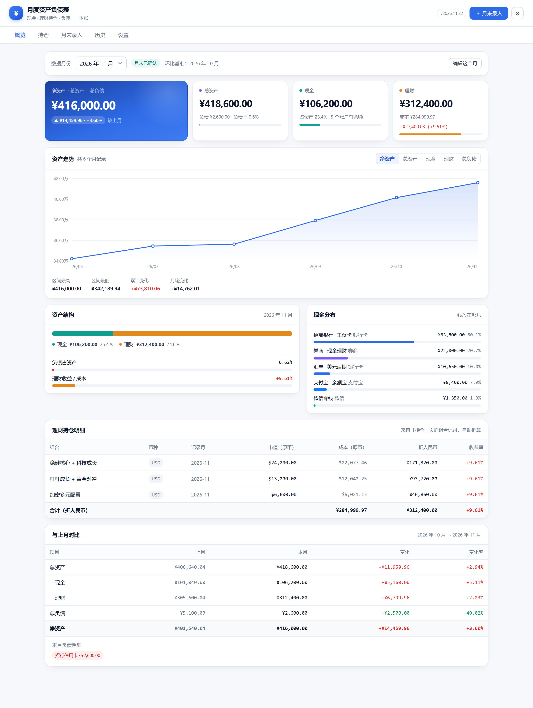
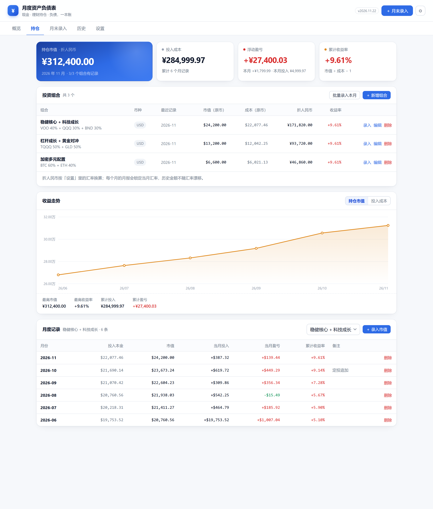
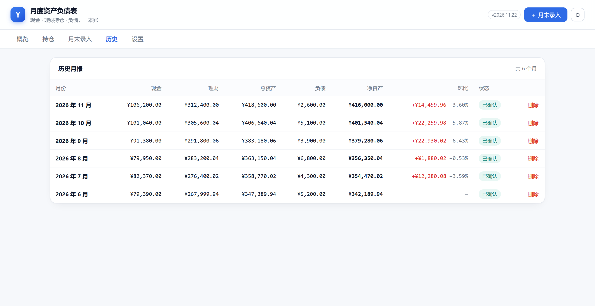
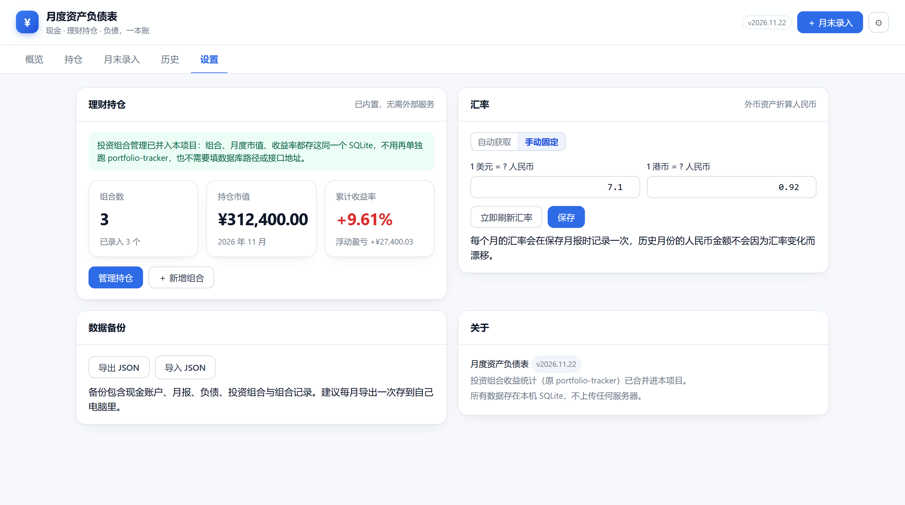
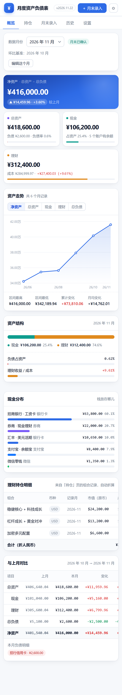

# 月度资产负债表

> 每月月底花三分钟，记下现金余额、录一下持仓市值，就能看到自己的净资产曲线。
> 投资组合收益统计（原 [portfolio-tracker](https://github.com/caddaric9527/portfolio-tracker)）已经**合并进本项目**，一套部署、一个数据库，不再需要第二个服务。



## 它解决什么问题

记账软件大多记的是「流水」，月底还是不知道自己有多少钱。这个工具只做一件事：**每个月存一张资产负债表快照**。

- **现金**：按「钱放在哪儿」逐个账户填（工资卡、支付宝、微信零钱、券商现金、美元活期…），支持 CNY / USD / HKD 自动折算人民币。
- **理财**：内置投资组合管理。每个组合每月录一次「投入本金 + 当前市值」，系统按当月汇率折成人民币带进月报，并保留每个组合的收益明细。
- **负债**：信用卡、房贷、借款，选填。
- **净资产** = 总资产 − 总负债，按月看走势、看环比、看资产结构。

## 界面

| 概览 | 持仓 |
| --- | --- |
|  |  |

| 月末录入 | 历史月报 |
| --- | --- |
|  |  |

| 设置（持仓 / 汇率 / 备份） | 手机端 |
| --- | --- |
|  |  |

## 快速开始

### 方式一：Docker（推荐）

```bash
git clone https://github.com/caddaric9527/monthly-balance-sheet.git
cd monthly-balance-sheet
cp .env.example .env      # 改一下 HOST_PORT 和 AUTH_PASSWORD
docker compose up -d --build
```

打开 `http://你的IP:8899`，用 `AUTH_PASSWORD` 登录。

### 方式二：直接跑

```bash
npm install
cp .env.example .env      # 可选
AUTH_PASSWORD=你的密码 PORT=8899 npm start
```

要求 Node.js ≥ 20（推荐 22）。数据默认落在 `./data/balance.db`。

## 理财持仓怎么用

「持仓」页把所有投资组合放在一起：

- **组合**：名称、计价币种（CNY / USD / HKD）、配置说明、定投计划。
- **月度记录**：每个组合每月一条 `投入本金`（累计）、`当前市值`、备注；同月重复提交是覆盖，方便改错。
- **批量录入**：一次把当月所有组合的市值填完，留空表示这个月不给该组合记账。
- **收益走势**：组合市值 / 投入成本两条曲线，外加最高市值、最高收益率、累计投入、累计盈亏。
- **月度记录表**：当月投入、当月盈亏、累计收益率，逐月可查可删。

月报里的「理财市值」= 各组合在当月（或之前最近一个月）的记录 × 当月锁定汇率，自动算出。**某组合当月没有记录时会沿用更早的最近一个月**，并在明细里标注「沿用」，避免缺记录时净资产突然掉一块。没有任何组合记录时，才退回手填。

### 从旧的 portfolio-tracker 迁数据

```bash
# 只读旧库，写入本项目的 data/balance.db
node scripts/import-legacy.mjs ../portfolio-tracker/data/portfolio.db
```

导入后打开「持仓」页即可看到；已有月报的理财金额会按内置持仓自动重算。旧库原封不动，可以留着对照。

## 数据模型

```
accounts            现金账户（位置）：名称、类型、币种、排序、归档
entries             每月每个账户的余额  UNIQUE(month, account_id)
liabilities         每月负债：名称、类型、金额、币种
portfolios          投资组合：名称、币种、配置说明、定投计划、归档
portfolio_records   组合月度记录：投入本金、市值  UNIQUE(portfolio_id, month)
investments         每月理财汇总缓存：市值/成本(CNY) + 组合明细 JSON + 来源
snapshots           每月元信息：备注、是否月末确认、当月汇率
```

- 每个月的汇率在**保存月报时记录一次**，历史月份的人民币金额不会因为汇率变动而漂移。
- 新月份打开时，未填写的账户会自动带出上月余额并标注「沿用」。
- 数据都在单个 SQLite 文件里，复制 `data/` 目录就是完整迁移。

## API

| 方法 | 路径 | 说明 |
| --- | --- | --- |
| GET | `/api/months` | 所有月份及汇总 |
| GET | `/api/snapshot/:month` | 某月完整快照（现金/负债/理财/环比） |
| PUT | `/api/snapshot/:month` | 保存整月数据（理财自动按持仓计算） |
| DELETE | `/api/snapshot/:month` | 删除某月 |
| POST | `/api/snapshot/:month/confirm` | 只切换「月末已确认」 |
| POST | `/api/snapshot/:month/recalc` | 按内置持仓重算该月理财 |
| GET/POST/PATCH/DELETE | `/api/accounts[/:id]` | 现金账户增删改查（删除默认归档） |
| GET | `/api/portfolios` | 组合列表 + 月度趋势 + 汇总 |
| POST/PATCH/DELETE | `/api/portfolios[/:id]` | 组合增删改（`?purge=1` 连同记录删除） |
| POST | `/api/portfolios/:id/records` | 录入/覆盖某组合某月市值 |
| DELETE | `/api/records/:id` | 删除一条组合月度记录 |
| POST | `/api/records/bulk` | 批量录入某月所有组合 |
| GET | `/api/trend` | 走势序列 + 缺月提示 |
| GET/PATCH | `/api/config` | 汇率配置 |
| POST | `/api/fx/refresh` | 立即刷新汇率 |
| GET/POST | `/api/export` `/api/import` | 备份与恢复（含组合与组合记录） |

除 `/api/health`、`/api/login`、`/api/session` 外都需要登录。

## 备份

- 界面「设置 → 导出 JSON」下载全量数据（现金、月报、负债、组合、组合记录）。
- 或直接备份 `data/balance.db`（连同 `-wal`、`-shm`，或先停容器）。
- 导入默认合并，同月份会覆盖。

## 安全说明

- 单密码 + HttpOnly Cookie 会话（默认 30 天），登录失败 10 分钟内 5 次即锁定。
- 未设置 `AUTH_PASSWORD` 时不启用认证，**请勿直接暴露到公网**。
- 没有任何外部服务凭据需要保存，数据只在本机 SQLite。
- 建议放在内网，或用反向代理加 HTTPS。

## 开发

```bash
npm run dev      # 改动后端自动重启
npm run smoke    # 无依赖冒烟测试：鉴权 → 建账户 → 录月报 → 环比 → 建组合 → 录市值 → 自动折算 → 备份恢复 → 删除
node scripts/seed-demo.mjs http://127.0.0.1:8899   # 灌 6 个月演示数据（会清空现有数据）
node scripts/shot.mjs "http://127.0.0.1:8899/?shot=overview" docs/screenshots 1360 1700  # 截图
```

技术栈：Node.js 22 + Express 4 + better-sqlite3，前端零依赖原生 JS（SVG 手绘图表）。

## 常见问题

**Q：还要不要单独部署 portfolio-tracker？**
A：不用了。2.0 起持仓管理是内置的，组合和记录都存在同一个 `balance.db`。老的 portfolio-tracker 可以只留作历史归档。

**Q：某个月忘了录入，曲线会断吗？**
A：不会补零。趋势图只连有记录的月份，`/api/trend` 会返回 `gaps` 标记缺了几个月；上月余额也会自动带出。

**Q：外币账户和外币组合怎么算？**
A：按币种 × 当月汇率折人民币，原始金额仍保留原币。

**Q：一个组合当月没记市值，会被算成 0 吗？**
A：不会。会沿用最近一个月，并在明细里标「沿用」。

## License

[MIT](LICENSE) © caddaric9527
